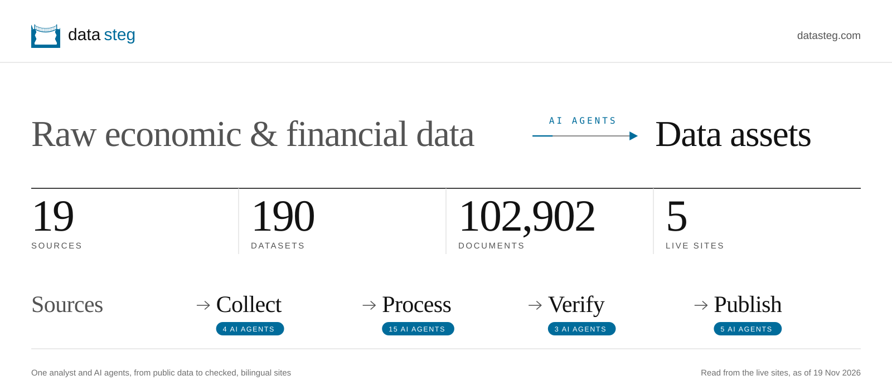
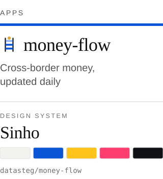
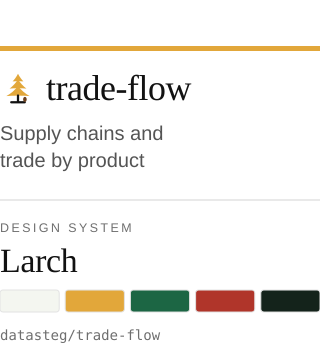
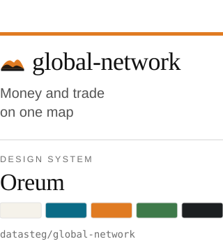
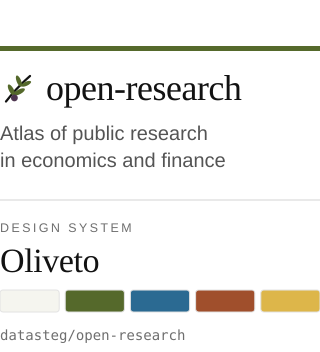
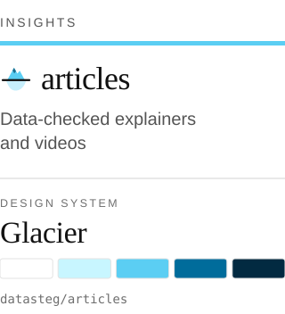

<a href="https://www.datasteg.com"><picture>
  <source media="(prefers-color-scheme: dark)" srcset="assets/hero-dark.svg">
  
</picture></a>

<a href="https://github.com/datasteg/money-flow"><picture><source media="(prefers-color-scheme: dark)" srcset="assets/card-money-flow-dark.svg"></picture></a>
<a href="https://github.com/datasteg/trade-flow"><picture><source media="(prefers-color-scheme: dark)" srcset="assets/card-trade-flow-dark.svg"></picture></a>
<a href="https://github.com/datasteg/global-network"><picture><source media="(prefers-color-scheme: dark)" srcset="assets/card-global-network-dark.svg"></picture></a>
<a href="https://github.com/datasteg/open-research"><picture><source media="(prefers-color-scheme: dark)" srcset="assets/card-open-research-dark.svg"></picture></a>
<a href="https://github.com/datasteg/articles"><picture><source media="(prefers-color-scheme: dark)" srcset="assets/card-articles-dark.svg"></picture></a>

**Live sites:** [money-flow](https://money-flow.datasteg.com) · [trade-flow](https://trade-flow.datasteg.com) ·
[global-network](https://global-network.datasteg.com) · [open-research](https://open-research.datasteg.com) ·
[articles](https://articles.datasteg.com)

datasteg turns public statistics and research into open data sites and bilingual explainers, in English and Korean,
built and checked by AI agents. Each repository here is the code of one live site, from the data to the page.

- **Collect.** Each publisher (BIS, IMF, the Fed, ECB, US Treasury, UN Comtrade, FRED, the Bank of Korea and others)
  has its own change probe. A file is stored again only when its content changed, and every vintage is kept.
- **Process.** AI agents read the research, choose the data and write the analysis. Plain code, written by AI agents
  and reviewed by a person, builds every table and computes every number.
- **Verify.** Every number in prose is a token tied to a computed fact. Builds are reproducible, the English and
  Korean editions must agree, and a failed blocking check means no release.
- **Publish.** Five sites, each in its own design system, plus a read-only [API and MCP server](https://www.datasteg.com/en/technology/api)
  over all of them. A person approves what goes out.

How each step is built: [Technology](https://www.datasteg.com/en/technology) ·
[All AI agents](https://www.datasteg.com/en/technology/agents) · [About](https://www.datasteg.com/en/about)

The repositories are read-only snapshots of the live sites' code; they do not include data, keys or the
servers. datasteg does not redistribute source data: the sites publish derived results only, and the original data
is at each publisher. © datasteg.
